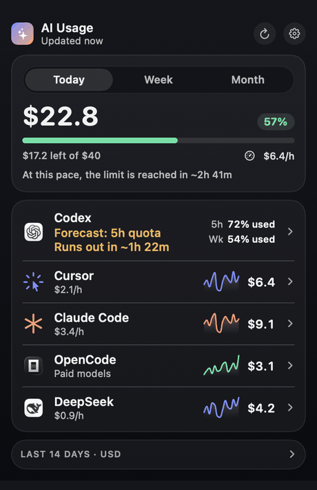
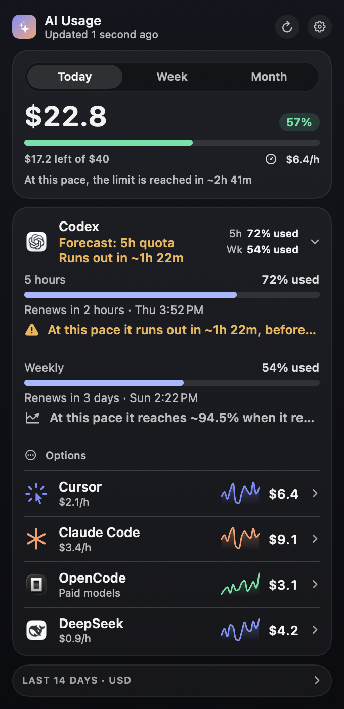
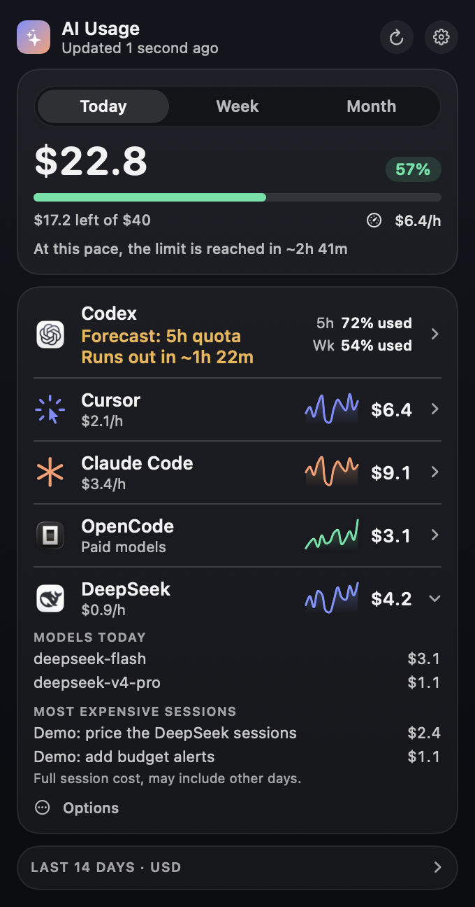
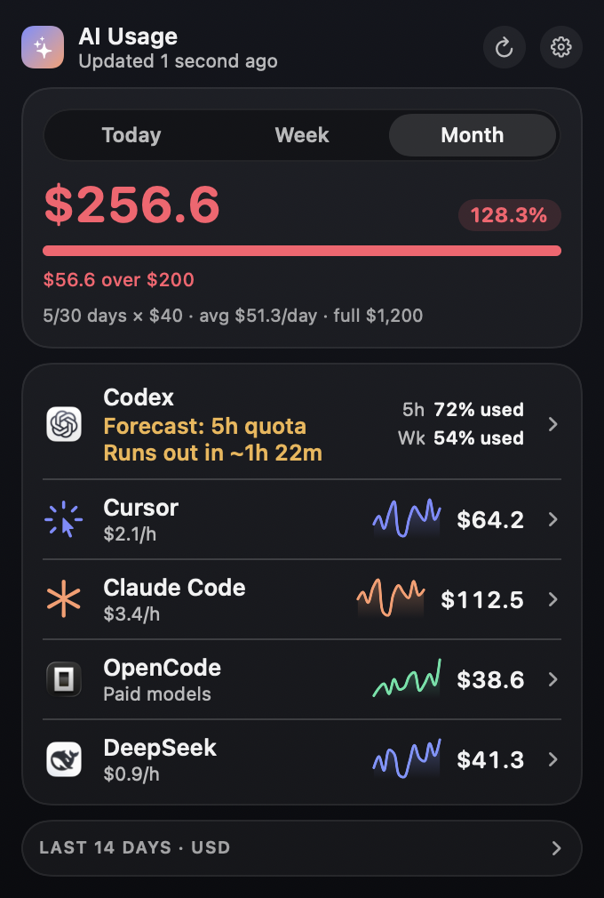

# AI Usage

**Spend, budgets and subscription quota for your AI coding tools — in the macOS menu bar.** One native popover for Cursor, Claude Code, OpenCode, Codex, DeepSeek and Pi, plus any harness you describe in a JSON spec.

[](https://github.com/marcusviniciusf/ai-usage-bar/actions/workflows/ci.yml)
[](https://github.com/marcusviniciusf/ai-usage-bar/releases/latest)
[](https://github.com/marcusviniciusf/ai-usage-bar/releases/latest)
[](LICENSE)

<p align="center">
  
</p>

[Screenshots](docs/images) use fictional demo data. No real account values are published.

## Install

### Homebrew

```bash
brew trust marcusviniciusf/tap
brew install --cask marcusviniciusf/tap/ai-usage
```

Homebrew 7 only loads casks from taps you trust, hence the first line. `brew upgrade` picks up new releases.

### Download

1. Download `AIUsage-<version>-macos-universal.zip` from [Releases](https://github.com/marcusviniciusf/ai-usage-bar/releases/latest).
2. Move **AI Usage.app** to Applications.
3. The build is ad-hoc signed (no paid Apple Developer ID), so macOS blocks the first launch once: open **System Settings → Privacy & Security → Open Anyway**, or right-click the app → Open.

### From source

```bash
git clone https://github.com/marcusviniciusf/ai-usage-bar.git
cd ai-usage-bar
./install.sh
```

Needs Xcode Command Line Tools. Builds the app into `~/Applications` and launches it; turn on **Launch at login** in the gear menu.

Universal (Apple Silicon + Intel), macOS 14+. No Node, no webview, no account, no telemetry. The collectors ship inside the app bundle.

## Why this one

- **One panel, two questions.** How much did I spend today, and how much quota do I have left? Costs, budgets and quota windows share the same compact popover instead of three dashboards.
- **DeepSeek priced correctly.** Local DeepSeek Harness sessions are priced at DeepSeek's published API rates, including the peak/off-peak windows most trackers flatten into one number.
- **Small and auditable.** A universal 2.8 MB binary, one SwiftUI source file, Python-standard-library collectors, 24 tests and a wire-compatibility check in CI. Nothing runs in the background besides a five-minute refresh.

## What it does

- **Spend:** today, week and month per tool, with model breakdown, most expensive sessions and a 14-day chart.
- **Budgets:** optional daily or monthly USD budget per tool plus a global daily budget, with alerts at 80% and 100% and a pace forecast.
- **Quota:** Codex 5-hour and weekly windows with a forecast of when you run out.
- **Menu bar:** a combined summary, a fixed tool, or pin up to two tools, each with its own icon.
- **Your own tools:** add any harness that logs tokens or cost to JSONL or SQLite with a small [JSON spec](docs/TOOL_SPECS.md), no code needed.
- **Focus:** only the tools found on your Mac appear; turn any of them off in the gear menu.
- **Languages:** English, Portuguese (Brasil) and Spanish.

## DeepSeek

`bin/ai-usage` reads the DeepSeek Harness session logs in `~/.dsh/sessions`, prices each `assistant/message` usage sample with the model that produced it, and bills a step once (retries replace, they do not add). A forked session's inherited prefix is skipped, so the same tokens are never counted twice.

Rates follow DeepSeek's published USD prices for `deepseek-flash` and `deepseek-v4-pro`. Peak windows are weekdays 01:00–04:00 and 06:00–10:00 UTC and cost twice the off-peak rate; Chinese public holidays are always off-peak and are not modelled, so holiday samples overestimate. Values are API list-price estimates, not your account balance.

## How it compares

Based on each project's README on 2026-11-05.

| | AI Usage | [CodexBar](https://github.com/steipete/CodexBar) | [TokenTracker](https://github.com/xiufengsun/TokenTracker) | [ccusage](https://github.com/ccusage/ccusage) |
|---|---|---|---|---|
| Interface | Native popover | Native menu bar | Desktop app + webview | Terminal CLI |
| Tools | 6 + JSON specs | 111 providers | 47 tools | Multi-agent CLI |
| DeepSeek spend | Local sessions, peak/off-peak | Balance via API key | Local sessions, flat price table | Via agent logs |
| Per-tool USD budget + alerts | ✅ | Partial, where the API exposes it | ❌ | ❌ |
| Runtime dependency | None (Swift) | None (Swift) | Node + webview | Node |
| Install | `brew install --cask` | `brew install --cask` | `brew install --cask` | `npx` |

**What this is not:** a 100-provider dashboard, a replacement for the `ccusage` CLI, or a hosted service. It is the small popover for people who use a handful of tools and want cost and quota without another account.

## Privacy

Everything runs locally. Nothing is sent anywhere except to the tools' own services:

- Claude Code: reads `~/.claude/projects` and prices tokens at Anthropic's list rates. OpenCode: reads the per-message cost in its local SQLite database. Both are estimates of API cost, not what a subscription bills.
- Claude Code quota (5-hour and weekly windows): if you signed in to Claude Code with a subscription, the app reads that token from the "Claude Code-credentials" Keychain item and calls Anthropic's own usage endpoint. It is read-only and hidden when no subscription token exists.
- DeepSeek: reads `~/.dsh/sessions`; nothing leaves the Mac.
- Codex: the official local `codex app-server` quota call.
- Cursor: uses your existing Cursor login. The app asks for the "Cursor Safe Storage" Keychain item (choose **Always Allow**, or macOS asks on every refresh) and calls the same undocumented `api2.cursor.sh` endpoint the Cursor usage page uses, so it can break if Cursor changes it. The decryption key is briefly passed to `/usr/bin/openssl` on the command line.

## Screenshots

<p align="center">
  
  
  
</p>

## Develop

```bash
git clone https://github.com/marcusviniciusf/ai-usage-bar.git
cd ai-usage-bar
./build.sh                              # build universal app + relaunch
python3 -m unittest discover -s tests -v
python3 tests/check_swift.py            # compiles old and current wire models
./scripts/package_release.sh 1.2.0      # release zip + SHA-256 in dist/
```

Needs Xcode Command Line Tools.

## More

- [Reference](docs/REFERENCE.md): detection, budgets, modes, CLI flags.
- [Changelog](CHANGELOG.md) · [Contributing](CONTRIBUTING.md) · [Security](SECURITY.md).
- Report security issues through the repository's private vulnerability reporting.

## License

MIT, see [LICENSE](LICENSE).
