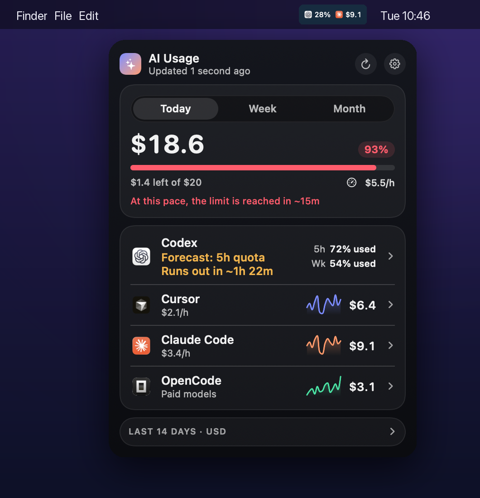
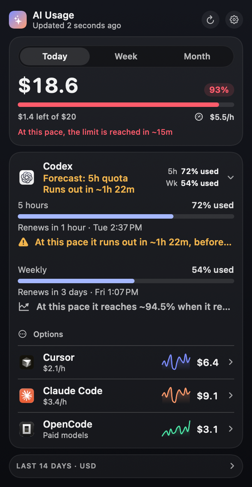
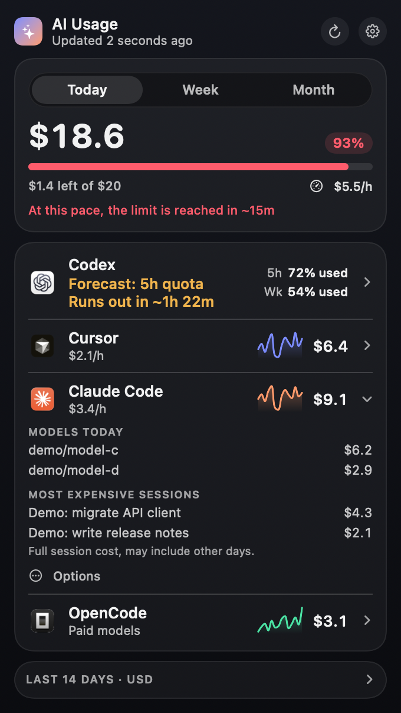
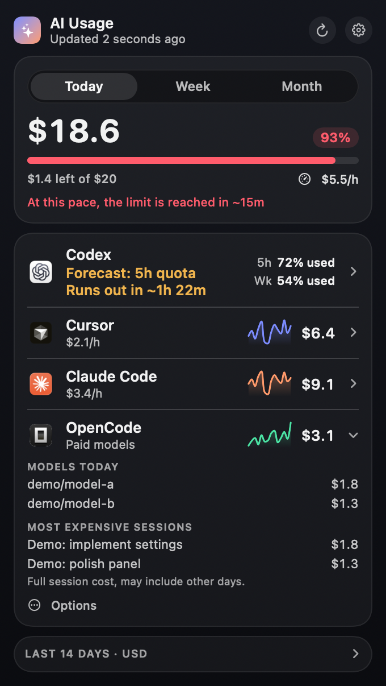

# AI Usage

A macOS menu bar app that shows what you spend on AI coding tools and how much subscription quota you have left. Cursor, Claude Code, OpenCode and Codex. macOS 14+, English, Portuguese and Spanish.

<p align="center">
  
</p>

<details>
<summary>More screenshots (fictional demo data)</summary>

<p align="center">
  
  
  
</p>

Regenerate with `python3 scripts/render_demo_screenshots.py && python3 scripts/render_hero.py` after rebuilding the app (the second needs Pillow).

</details>

## Install

```bash
git clone https://github.com/marcusviniciusf/ai-usage-bar.git
cd ai-usage-bar && ./install.sh
```

Needs Xcode Command Line Tools. [Bun](https://bun.sh) or npm is only needed for Claude Code and OpenCode (installs `ccusage`). The app lands in `~/Applications/AI Usage.app`; turn on **Launch at login** in its gear menu.

## What it does

- **Spend:** today, week and month per tool, with optional daily or monthly budgets and alerts at 80% and 100%.
- **Quota:** Codex windows (5 hours, weekly) with a forecast of when you hit the limit.
- **Menu bar:** a compact summary, or pin up to 2 tools.
- Only tools it finds on your Mac appear. Turn any of them off in the gear menu.

## Privacy

Everything runs locally and nothing is sent anywhere except to the tools' own services:

- Claude Code and OpenCode: read from local logs through `ccusage`. Values are API list-price estimates, not what a subscription bills.
- Codex: the official local `codex app-server` quota call.
- Cursor: uses your existing Cursor login. The app asks for the "Cursor Safe Storage" Keychain item (choose **Always Allow**, or macOS asks on every refresh) and calls the same undocumented `api2.cursor.sh` endpoint the Cursor usage page uses, so it can break if Cursor changes it. The decryption key is briefly passed to `/usr/bin/openssl` on the command line.

## More

[Reference](docs/REFERENCE.md): budgets, CLI flags, detection, languages, tests. Report security issues through the repository's private vulnerability reporting.

## License

MIT, see [LICENSE](LICENSE).
